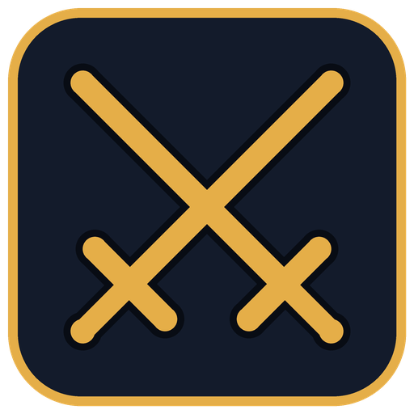

<p align="center"></p>

<h1 align="center">Jarvis PvP</h1>

<p align="center"><b>Clear plates for every player in FFXIV PvP: HP, MP, Limit Break, Guard, debuffs, signs and who has you as their target.</b><br>
A Dalamud plugin, based on <a href="https://github.com/Petra105/PvPTopPlates">PvP TopPlates</a> by Petra105.</p>

<p align="center">


<a href="https://boosty.to/aloyb"></a>
</p>

---

## What it does

Every player in PvP gets a plate that terrain and walls cannot hide, drawn from the character's position in the world:

- **HP bar** with the barrier drawn in its own colour, **MP bar** and the **Limit Break gauge** of every player
  (read from the Crystalline Conflict team lists; blinks when full).
- **Job icon** (party list style, gold glyph or light tile) that fills up while the player drinks a
  Standard-issue Elixir.
- **Guard**: the hotbar icon with a ready / active / recast border, a glow while active and the recast countdown,
  for allies and enemies.
- **Debuffs** on enemies, allies and yourself, each with its own position (under, over, right of Guard, left of the
  job icon), with time left and an optional border around your own debuffs.
- **Signs** (attack 1-8, bind, ignore, shapes) moved above the whole plate.
- **Enemies targeting you**: a role-colour dot under them, their job icons above your head, a red glow and crossed
  swords on their job icon.
- **Name and HP text** in several formats, plate above the head or under the feet, follows jumps and dashes exactly.

### The settings window (`/jpvp`)

- Pages: Preview, General, Bars, Text, Icons, Debuffs & signs, Targeting me, Appearance, Diagnostics, About.
- A **live preview** of you, your target and an ally, animated. On each settings page it shows only what that page
  sets.
- **Test in world**: a sample enemy plate above your own character, to set everything up without a match.
- Themes: Midnight blue, Black, Light and Crystal (classic blue Final Fantasy menu).
- Interface in English, French, German and Japanese, with the official game terms of each language.

## Plays by the rules

- It only **shows what the game already knows** (HP, statuses, targets, the team lists). It never acts for you,
  never presses buttons and never automates anything.
- **No network requests.** The log and reports stay on your PC until you paste them somewhere yourself.
- The game's own UI is never changed, except that a sign over a player can be hidden while Jarvis PvP draws it above
  the plate (option).

## Installing

1. In game, open `/xlsettings` → **Experimental**.
2. Under **Custom Plugin Repositories**, add this URL, tick **Enabled** and press **Save**:

   ```
   https://raw.githubusercontent.com/Kwuwa/JarvisPvP/main/repo.json
   ```

3. Open `/xlplugins`, search for **Jarvis PvP**, install it and type `/jpvp`.

Updates arrive through the plugin installer like for any other plugin.

> If you use the original PvP TopPlates, turn it off: both draw plates for the same players.

## Commands

| Command | What it does |
|---|---|
| `/jpvp` | Opens or closes the settings |
| `/jpvp on` / `off` / `toggle` | Turns the plates on, off or switches them |

## Something not working?

1. Open `/jpvp` → **Diagnostics**. For problems with Guard, Elixir or targeting, turn on **Record game events**
   first and make the problem happen again.
2. Press **Report a problem**: the report (version, settings, log) is copied and a new GitHub issue opens. Describe
   what happened and paste the report with Ctrl+V.

Recorded events contain character names, so look over the report before sending it.

## Support

Jarvis PvP is free. If you like it, you can support me on [Boosty](https://boosty.to/aloyb).

## Credits

- Original plugin: [PvP TopPlates](https://github.com/Petra105/PvPTopPlates) by Petra105 (MIT licence).
- Made with the help of the AI Claude (Anthropic): ideas and the creation of features.
- Thanks to the Dalamud and FFXIVClientStructs teams.

## Building from source

.NET 10 SDK: `dotnet build PvPTopPlates.sln -c Release`. The plugin is in `PvPTopPlates/bin/x64/Release/`
(`JarvisPvP.dll`); add it under `/xlsettings` → Experimental → Dev Plugin Locations to load it as a dev plugin.

## Licence

MIT, see [LICENSE](LICENSE). Copyright (c) 2026 Petra105, copyright (c) 2026 Kwuwa for the Jarvis PvP changes.

FINAL FANTASY XIV © SQUARE ENIX. Jarvis PvP is not affiliated with or endorsed by Square Enix.
